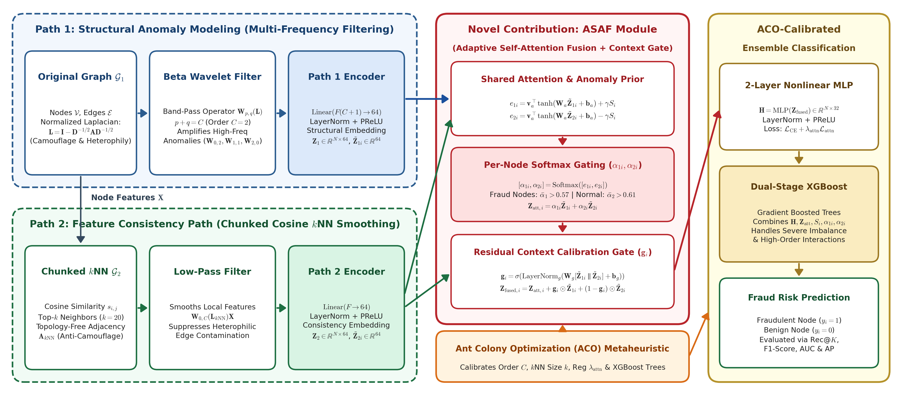

<div align="center">

# 🛡️ ASAF-GFD: Adaptive Self-Attention Fusion for Graph-Based Financial Fraud Detection

**Graph-Based Financial Fraud Detection with Dual-Path Spectral-Spatial Filtering, Adaptive Self-Attention Fusion, and Ant Colony Metaheuristic Optimization**

[](https://www.python.org/)
[](https://pytorch.org/)
[](https://www.dgl.ai/)
[](https://xgboost.readthedocs.io/)
[-B31B1B?logo=adobeacrobatreader&logoColor=white)](./ASAF_GFD_Research_Paper.pdf)
[](https://opensource.org/licenses/MIT)

**Authors:** **Geetansh Gautam** and **Dr. Rajeev Kumar**  
*Department of Computer Science and Engineering (AI & ML), DAV Institute of Engineering and Technology (DAVIET), Jalandhar, India*

[📄 **Read Full 18-Page Research Paper (PDF)**](./ASAF_GFD_Research_Paper.pdf) • [📦 **LaTeX Source**](./ASAF_GFD_LaTeX_Source)

</div>

---

## 🌟 Overview & Key Contributions

Real-world financial transaction graphs simultaneously suffer from **relation camouflage**, **high heterophily**, and **extreme class imbalance**. While recent dual-path GNNs (such as DPF-GFD) decouple high-frequency structural anomaly extraction ($\mathcal{G}_1$) from $k$NN feature-consistency smoothing ($\mathcal{G}_2$), they rely on rigid **static concatenation** ($Z = [Z_{1i} \Vert Z_{2i}]$), enforcing a uniform 50%–50% path importance across all nodes.

**ASAF-GFD** resolves this limitation via four core innovations:
1. **Node-Adaptive Self-Attention Fusion (ASAF) Module:** Dynamically computes per-node attention weights $(\alpha_{1i}, \alpha_{2i})$ with $\alpha_{1i} + \alpha_{2i} = 1$ and a dimension-wise **Residual Context Calibration Gate** ($\mathbf{g}_i$).
2. **Scale-Adaptive Structural Anomaly Prior ($S_i$):** Combines inductive gradient-boosted anomaly priors on compact corporate networks with unsupervised spectral-to-smoothness energy ratios on massive transaction graphs.
3. **Memory-Efficient Chunked Cosine $k$NN Graph ($\mathcal{G}_2$):** Reduces $k$NN similarity graph construction memory from $\mathcal{O}(N^2)$ to $\mathcal{O}(B_{\text{chunk}}N + Nk)$.
4. **Ant Colony Optimization (ACO) Metaheuristic Calibration:** Jointly optimizes Beta wavelet polynomial order $C$, $k$NN size $k$, attention regularization $\lambda_{\text{attn}}$, and dual-stage XGBoost parameters.

---

## 🏗️ System Architecture

<p align="center">
  
</p>

---

## 📊 Benchmark Results (16 / 16 Metric Dominance)

Evaluated over **5 independent stratified random seeds** (`{42, 100, 2024, 777, 999}`) across four real-world financial fraud datasets:

| Dataset | Domain | Nodes ($N$) | Edges ($M$) | Model | Rec@K (%) | F1-Score (%) | AUC (%) | AP (%) |
| :--- | :--- | :---: | :---: | :--- | :---: | :---: | :---: | :---: |
| **FDCompCN** | Corporate Fraud | 5,317 | 4,595 | DPF-GFD (Base) | 33.10 ± 2.76 | 36.14 ± 2.41 | 68.41 ± 3.25 | 28.07 ± 1.89 |
| **FDCompCN** | Corporate Fraud | 5,317 | 4,595 | **ASAF-GFD (Ours)** | **40.95 ± 0.58** | **43.90 ± 2.40** | **79.34 ± 2.22** | **40.59 ± 3.74** |
| **FFSD** | Credit Card | 77,881 | 94,902 | DPF-GFD (Base) | 58.77 ± 2.04 | 61.22 ± 1.38 | 86.25 ± 0.81 | 70.36 ± 1.54 |
| **FFSD** | Credit Card | 77,881 | 94,902 | **ASAF-GFD (Ours)** | **60.69 ± 1.72** | **62.27 ± 1.32** | **88.58 ± 0.60** | **72.77 ± 1.21** |
| **Elliptic** | Bitcoin AML | 203,769 | 234,355 | DPF-GFD (Base) | 87.57 ± 0.71 | 89.08 ± 0.65 | 97.43 ± 0.52 | 93.17 ± 0.89 |
| **Elliptic** | Bitcoin AML | 203,769 | 234,355 | **ASAF-GFD (Ours)** | **88.09 ± 0.48** | **89.35 ± 0.44** | **98.08 ± 0.15** | **93.82 ± 0.31** |
| **T-Finance** | Financial Lending | 39,357 | 42,484,443 | DPF-GFD (Base) | 81.75 ± 2.25 | 83.92 ± 1.98 | 94.84 ± 0.94 | 85.90 ± 1.86 |
| **T-Finance** | Financial Lending | 39,357 | 42,484,443 | **ASAF-GFD (Ours)** | **82.33 ± 1.88** | **84.56 ± 1.46** | **95.13 ± 1.24** | **86.82 ± 1.81** |

---

## 📂 Repository Structure

```text
BTech_Capstone_ASAF/
├── models/                        # Dual-Path Beta Wavelet, Chunked kNN, and ASAF-GFD neural modules
├── utils/                         # Graph preprocessing, spectral operators, and evaluation metrics
├── notebooks/                     # Interactive exploratory analysis and visualization notebooks
├── results/                       # Saved 5-seed experimental logs, JSON metrics, and plots
├── ASAF_GFD_LaTeX_Source/         # Complete 18-page two-column LaTeX manuscript & high-res figures
├── ASAF_GFD_Research_Paper.pdf    # Compiled publication-ready 18-page research paper
├── main.py                        # Entry-point script for single-dataset training and evaluation
├── train.py                       # Core training loop with class-weighted CE + attention loss
├── run_real_4datasets.py          # Full 5-seed benchmark suite across FDCompCN, FFSD, Elliptic, T-Finance
├── run_aco_soft_computing.py      # Ant Colony Optimization (ACO) metaheuristic calibration engine
├── generate_paper_figures.py      # Script to reproduce all 8 publication figures (300 DPI)
└── requirements.txt               # Python package dependencies
```

---

## 🚀 Quickstart & Reproducibility

### 1. Environment Setup
```bash
git clone [https://github.com/](https://github.com/)<YOUR-GITHUB-USERNAME>/ASAF-GFD-Financial-Fraud-Detection.git
cd ASAF-GFD-Financial-Fraud-Detection
pip install -r requirements.txt
```

### 2. Run Full 4-Dataset Benchmark (5 Seeds)
```bash
python run_real_4datasets.py
```

### 3. Run ACO Metaheuristic Hyperparameter Optimization
```bash
python run_aco_soft_computing.py
```

### 4. Regenerate All Publication Figures
```bash
python generate_paper_figures.py
```

---

## 📝 Citation

If you find this repository or our paper useful in your research, please cite:

```bibtex
@article{gautam2026asaf,
  title={Graph-Based Financial Fraud Detection with Dual-Path Spectral-Spatial Filtering, Adaptive Self-Attention Fusion, and Ant Colony Metaheuristic Optimization (ASAF-GFD)},
  author={Gautam, Geetansh and Kumar, Rajeev},
  journal={Preprint Submitted to Elsevier / IEEE},
  year={2026},
  institution={DAV Institute of Engineering and Technology (DAVIET), Jalandhar}
}
```